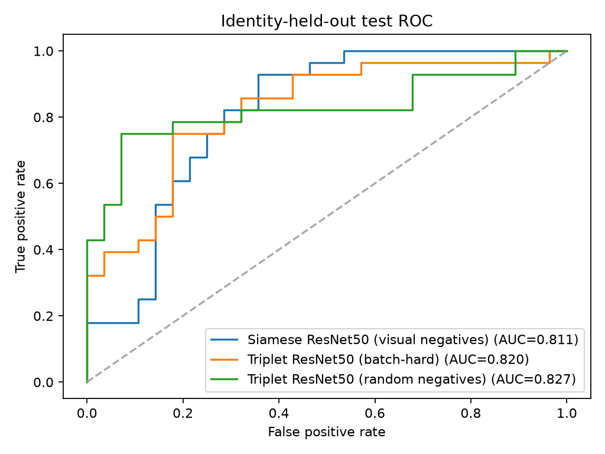
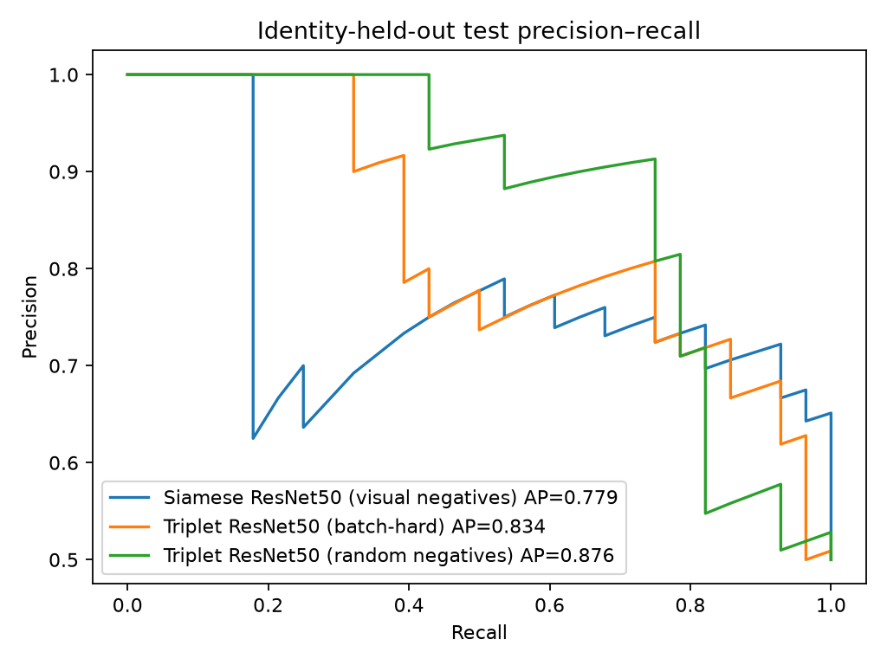

# Experimental results

## Refined handbag experiment

The initial broad ABO sample was audited and narrowed before this experiment. The retained scope is handbags, purses, and fashion bags verified from product type and listing-title metadata. Backpacks, luggage, suitcases, wallets, camera bags/cases, and grocery-style totes are excluded. See the [dataset audit](handbag_dataset_audit.md) for the filter rules, exclusions, and per-identity counts.

- **Data:** 248 valid catalog images from 66 product identities. Two identities have only one image. There were no invalid retained images and no repeated image hashes among retained records.
- **Split:** seed 42, identity-disjoint: train 52 identities / 196 images; validation 7 / 24; test 7 / 28. Pair evaluation uses 47 validation pairs and 56 test pairs (28 positive, 28 negative). Retrieval has 28 test queries, each with at least one same-identity test image.
- **Hardware and input:** CPU-only, Intel Core i5-13500H, 224×224 ImageNet-normalized images, ResNet50 initialized from ImageNet weights, 256-dimensional normalized embeddings. The Siamese run trained the final backbone block and projection; triplet runs used the same partial fine-tuning setup. All runs used seed 42, AdamW at 0.0001, maximum 20 epochs, and early stopping patience 5.
- **Pair generation/mining:** Siamese pairs use different-image positives and visual-neighbor negatives between different identities. The triplet experiment compares batch-hard in-batch negative mining with random in-batch negatives.

### Held-out test results

The threshold for each learned model was selected only on its validation pairs by maximizing validation F1 (ties prefer precision and then a higher threshold). The production model was selected by validation F1, with validation precision as the tie-breaker. DINOv2 is a retrieval-only baseline and did not participate in threshold selection.

| Model | Epochs completed (best checkpoint) | Test accuracy | Precision | Recall | F1 | ROC AUC | Average precision | Retrieval R@1 / R@5 / R@10 | Retrieval mAP | CPU latency / image |
|---|---:|---:|---:|---:|---:|---:|---:|---:|---:|---:|
| Siamese ResNet50, visual negatives **(selected)** | 15 (10) | 0.732 | 0.760 | 0.679 | 0.717 | 0.811 | 0.779 | 0.714 / 0.893 / 1.000 | 0.509 | 63.8 ms |
| Triplet ResNet50, batch-hard | 9 (4) | 0.750 | 0.706 | 0.857 | 0.774 | 0.820 | 0.834 | 0.750 / 0.964 / 1.000 | 0.531 | 83.6 ms |
| Triplet ResNet50, random negatives | 9 (4) | 0.750 | 0.719 | 0.821 | 0.767 | 0.827 | 0.876 | 0.786 / 0.929 / 0.964 | 0.547 | 47.8 ms |
| Frozen DINOv2-base, retrieval only | — | — | — | — | — | — | — | 0.429 / 0.857 / 0.929 | 0.436 | 168.9 ms |

Selected-model validation calibration: cosine threshold **0.55846**, precision **0.818**, recall **0.783**, F1 **0.800** on 47 pairs. At that fixed threshold, the test confusion matrix is **TN 22, FP 6, FN 9, TP 19**. The selected ResNet50 checkpoint is approximately 92 MiB. Frozen DINOv2-base is approximately 330 MiB.

The Siamese run completed 15 epochs, with its best validation-loss checkpoint at epoch 10. It was resumed after an initial six-epoch process; the saved run timer covers the resumed process (12 min 7 sec), not the full experiment wall time. Both triplet runs completed 9 epochs and stopped early; each timed process took about 2 min 23 sec. The reported CPU latency is a 20-repeat average after three warmups and can vary with system load.

### Measured curves

### Interpretation and limitations

These are preliminary measurements, not evidence of deployment readiness. The held-out set contains only seven product identities and 56 balanced pairs; each metric can move substantially with a few examples. The validation threshold is tied to the selected checkpoint hash, but its 47-pair calibration set is also small. Product listing identity means the same catalog product/model, not the same physical handbag. ABO studio images do not establish performance on customer photos, varied backgrounds, occlusions, or real duplicate-catalog workloads. The validation-F1 selection rule is fixed in advance in code, while the test metrics above remain held out from model/threshold selection.

The first capped experiment (855 images, 235 identities, one training epoch) is retained in repository history for reproducibility; it is superseded by this filtered experiment and should not be represented as the final training run. Local image files, checkpoints, and machine-generated JSON/CSV are intentionally excluded from Git. The audit, measured summary, and plotted curves are tracked here.
